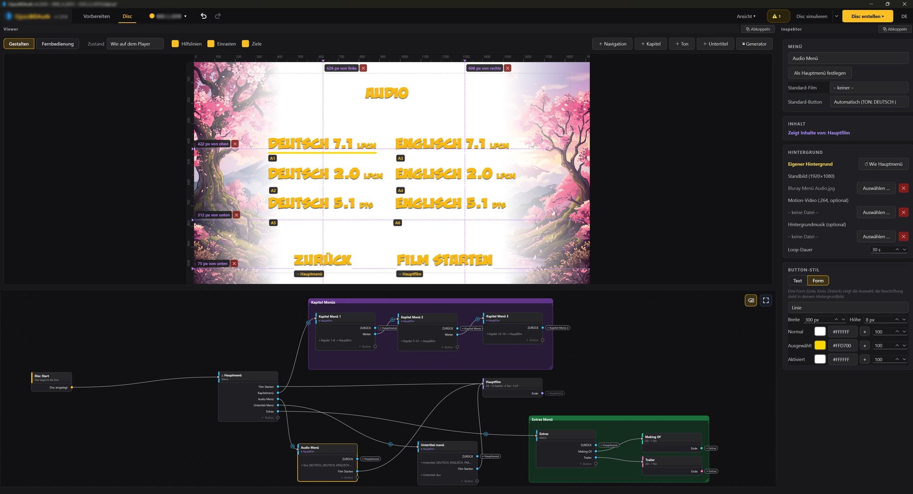
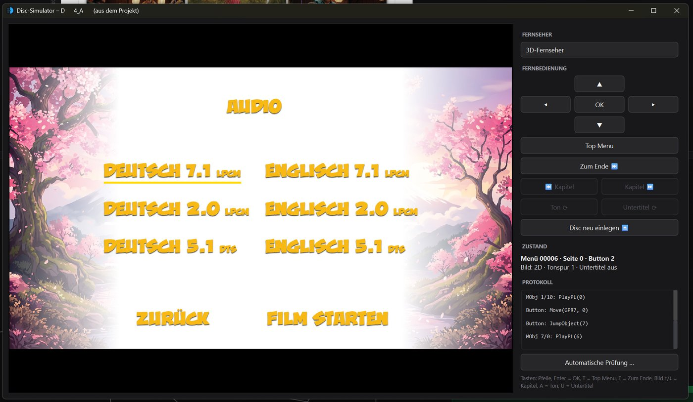

# OpenBDAuth

[](README.md)
[](README.de.md)

[](CHANGELOG.md)
[](#plattformen)
[](../../releases/latest)
[](https://www.python.org/)
[](LICENSE)

[](#funktionen)
[](#funktionen)
[](#funktionen)
[](#formate)
[](#formate)
[](#funktionen)
[](#disc-prüfen)
[](#funktionen)

**OpenBDAuth** ist ein freies Blu-ray-Authoring-Programm. Es macht aus eigenem Videomaterial **2D- und 3D-Blu-rays (MVC)** mit **echten HDMV-Menüs** – Pfeiltasten-Navigation, mehrere Menüseiten, Kapitel-, Ton- und Untertitelmenüs – als BDMV-Ordner oder brennfertige ISO. Ein eingebauter Encoder bereitet beliebiges Material (MP4, MOV, MKV, 3D als Full-TAB/SBS) Blu-ray-gerecht vor.

Alles geschieht in einer grafischen Oberfläche: Die Disc entsteht als Knoten-Graph, Menüs werden direkt im Viewer gestaltet. Die Oberfläche gibt es auf Deutsch und Englisch.



*Arbeitsbereich Disc: Menü-Designer mit Hilfslinien und Ziel-Plaketten, Knoten-Graph mit Rahmen, Inspektor.*



*Disc-Simulator: die Disc vor dem Brennen mit der virtuellen Fernbedienung durchklicken.*

## Stand

OpenBDAuth wird von einer Person entwickelt und auf der vorhandenen Hardware getestet:

- **Player:** Sony UBP-X700, Sony BDP-S4200, PlayStation 3 und ein Panasonic DMP-BDT111EG (2D, 3D, Menüs, Kapitel, Ton- und Untertitelwahl – Einzelheiten in **[HARDWARE_TESTS.md](HARDWARE_TESTS.md)**). Andere Player können sich anders verhalten; der HDMV-Standard lässt Spielraum.
- **Brennen:** bestätigt unter Windows und macOS mit einem Laufwerk (HL-DT-ST BP40NS20, BD-RE). Brennen unter Linux ist neu und wird gerade getestet.
- **Software-Player** wie VLC können Blu-ray-Menüs nur teilweise. Kodi oder ein Hardware-Player zeigen verlässlicher, wie die Disc wirkt.

Bevor du viele Discs brennst, teste eine auf deinem Player – dafür eignet sich eine BD-RE. Rückmeldungen mit dem Player-Modell sind sehr willkommen.

---

## Funktionen

### Drei Arbeitsbereiche

- **Vorbereiten** – macht aus beliebigem Material Disc-fertige Dateien:
  - 2D-Video (H.264, Blu-ray-konform; 720p/1080, 25p als PsF, 30/60 fps werden auf 29,97/59,94 angepasst)
  - 3D-Video aus Full-TAB (1920 × 2160) oder Full-SBS (3840 × 1080) als MVC (`.264` + `.mvc`), eigener plattformübergreifender MVC-Weg
  - Ton (AC-3, DTS, LPCM; 1:1-Übernahme, wo möglich)
  - Warteschlange: alles hineinziehen, je Datei festlegen, über Nacht abarbeiten lassen; Füllstand für BD-25/BD-50
  - Ergebnisse kommen nur per Klick in die Disc („In Film-Knoten übernehmen“)
- **Disc** – baut die Blu-ray als Knoten-Graph:
  - Start-, Film- und Menü-Knoten; eine Verbindung ist ein Sprung (Button → Film, Film-Ende → Menü, Film → Film)
  - Viewer als Menü-Designer: Buttons frei platzieren, Hilfslinien, Abstands- und Ausrichtungshilfe, Title-Safe-Rahmen; Fernbedienungs-Modus zum Durchprobieren
  - Kapitel- und Sprachmenüs aus Vorlagen, eigene Hintergründe (Bild oder Video, mit Musik) pro Menü
  - 3D-Filme wahlweise in 2D starten („Play 2D“)
  - Prüfung vor dem Export und **Disc-Simulator**: das Projekt oder eine fertige Disc mit virtueller Fernbedienung durchklicken, ohne zu brennen
- **Brennen** – schreibt eine fertige ISO 1:1 auf Blu-ray (Windows, macOS und Linux):
  - beliebig oft, ohne neu zu packen; zuletzt verwendete ISOs, bis zu 10 Kopien
  - BD-R und BD-RE (wird bei Bedarf gelöscht), Prüfen nach dem Brennen auf Wunsch, Auswerfen nur nach Erfolg

### Erzeugte Blu-ray

- **HDMV-Menüs** (Interactive Graphics, vorgeladener Menüstrom), Seitenwechsel ohne Ladepause, Buttons mit den Zuständen normal / ausgewählt / aktiviert
- **Kapitel, Ton und Untertitel** aus dem Menü; eine im Film gewählte Spur bleibt beim nächsten Start erhalten
- **3D (MVC)** mit SSIF-Interleaving; Umschaltung auf 3D nur auf 3D-fähigen Playern, auf 2D-Fernsehern läuft der Film in 2D
- **ISO** mit eigener UDF-2.50-Engine (große Dateien, 3D-Interleaving)
- **Disc-Titel** im Player statt „BD-RE“
- Mitgelieferte Schriften (Liberation Sans, Noto Sans) für Buttons und Untertitel

### Formate

| Art | Disc-Seite (direkt) | Vorbereiten (wird umgewandelt) |
|---|---|---|
| Video | H.264-Elementarstrom (`.264`), `.m2ts` | alles, was ffmpeg liest (MP4, MOV, MKV, …) |
| 3D | `.264` + `.mvc` (23,976 / 24 fps) | Full-TAB 1920 × 2160 oder Full-SBS 3840 × 1080, 23,976 / 24 fps |
| Ton | AC-3, E-AC-3, DTS / DTS-HD, Dolby TrueHD, WAV (LPCM) | WAV, FLAC und weitere Tondateien (z. B. MP3, AAC); Stereo, 5.1 und 7.1 |
| Untertitel | `.srt` (eigener Renderer), `.sup` (PGS) | – |
| Kapitel | DaVinci-Resolve-Marker-EDL (`.edl`) | – |

Dolby-TrueHD- und DTS-HD-Spuren werden unverändert auf die Disc übernommen; selbst erzeugen kann OpenBDAuth sie nicht. Dolby Atmos und DTS:X in solchen Spuren kommen dabei mit, sind auf Hardware aber noch nicht getestet.

Den Ton einer Videodatei übernimmt Vorbereiten bewusst nicht: Aus dem Video entsteht nur das Bild. Der Ton gehört als eigene Datei in guter Qualität dazu (am besten WAV aus dem Schnittprogramm), damit nicht versehentlich eine stark komprimierte Spur auf der Disc landet.

---

## Installation

### Plattformen

Fertige Pakete gibt es auf der **[Releases-Seite](../../releases/latest)**. Sie enthalten alles, was OpenBDAuth braucht (Python, Qt, ffmpeg, ffprobe, tsMuxeR); sonst muss nichts installiert werden.

| System | Datei | Voraussetzungen |
|---|---|---|
| Windows | `OpenBDAuth-Setup-<Version>.exe` (Installer) oder `OpenBDAuth-<Version>-windows.zip` (ohne Installation) | Windows 10 oder 11, 64 Bit |
| Linux | `OpenBDAuth-<Version>-linux.tar.gz` | x86-64 mit glibc 2.35 oder neuer: Ubuntu 22.04, Debian 12, Fedora 36, Linux Mint 21 oder neuer |
| macOS | `OpenBDAuth-<Version>-macos.dmg` | Apple Silicon (M1 oder neuer), macOS 13 oder neuer – Intel-Macs werden nicht unterstützt |

Die Pakete sind noch nicht mit einem kommerziellen Zertifikat signiert; Windows und macOS fragen deshalb vor dem ersten Start einmal nach (siehe unten).

### Windows

- **Installer:** `OpenBDAuth-Setup-<Version>.exe` ausführen. Er installiert für deinen Benutzer ohne Admin-Rechte (auf Wunsch für alle Benutzer) und legt einen Eintrag im Startmenü an; deinstallieren über Einstellungen → Apps.
- **Ohne Installation:** ZIP an beliebiger Stelle entpacken und `OpenBDAuth.exe` starten. Zum Entfernen den Ordner löschen.
- **Erster Start:** Meldet SmartScreen „Der Computer wurde durch Windows geschützt“, auf **Weitere Informationen** → **Trotzdem ausführen** klicken.

### Linux

```bash
tar xzf OpenBDAuth-<Version>-linux.tar.gz
./OpenBDAuth/OpenBDAuth
```

Es wird nichts installiert; zum Entfernen den Ordner löschen.

**Brennen unter Linux** braucht `xorriso` vom System und Zugriff auf das Laufwerk:

```bash
sudo apt install xorriso            # Ubuntu, Debian, Mint (Fedora: dnf install xorriso, Arch: pacman -S libisoburn)
sudo usermod -aG cdrom $USER        # Arch/Fedora: Gruppe optical; danach ab- und wieder anmelden
```

ISOs im Simulator öffnen nutzt `udisksctl` (auf Desktops vorhanden).

### macOS

1. Das `.dmg` öffnen und **OpenBDAuth** auf **Programme** (Applications) ziehen.
2. **Erster Start:** macOS meldet, dass es OpenBDAuth nicht überprüfen kann. Auf **Fertig** klicken, **Systemeinstellungen → Datenschutz & Sicherheit** öffnen, nach unten scrollen und bei OpenBDAuth auf **Dennoch öffnen** klicken, dann bestätigen. Das ist nur einmal nötig.
3. Meldet macOS, die App sei „beschädigt und kann nicht geöffnet werden“, einmal im Terminal ausführen:

   ```bash
   xattr -dr com.apple.quarantine /Applications/OpenBDAuth.app
   ```

### Aus dem Quellcode

Voraussetzungen: Python 3.10 oder neuer.

```bash
python -m venv venv
venv\Scripts\activate            # macOS/Linux: source venv/bin/activate
pip install -r requirements.txt
python tools/fetch_tools.py      # ffmpeg, ffprobe und tsMuxeR nach tools/<plattform>/ (Windows, Linux, macOS)
python main.py                   # oder Start_OpenBDAuth.bat
```

Ohne `tools/<plattform>/` sucht OpenBDAuth ffmpeg, ffprobe und tsMuxeR im PATH. Ein Paket für das laufende System baut `python tools/build_release.py`; es prüft sich danach selbst (`OpenBDAuth.exe --selbsttest`); unter Windows mit [Inno Setup 6](https://jrsoftware.org/isinfo.php) entsteht auch der Installer. Auf GitHub bauen die Workflows „Windows-Paket“, „Linux-Paket“ und „macOS-Paket“ die Pakete (Actions → Workflow → „Run workflow“).

---

## Typischer Ablauf

1. **Vorbereiten:** Filme, Extras und Tonspuren hineinziehen, je Datei festlegen (2D/3D, Bitrate, Ton), **Starten**.
2. **Übernehmen:** fertige Dateien per Klick in Film-Knoten übernehmen (oder schon vorher „Neuer Film-Knoten …“ als Ziel wählen).
3. **Disc:** Menüs anlegen und gestalten, Kapitel- und Sprachmenüs über die Vorschläge im Graphen, Untertitel und Kapitel auf den Film-Knoten ziehen.
4. **Disc simulieren** und mit der Fernbedienung durchklicken.
5. **Disc erstellen** (Ordner oder ISO), unter **Brennen** auf Blu-ray schreiben, auf dem Player testen.

## Disc prüfen

```bash
python tools/simulate_disc.py <ISO | Disc- oder BDMV-Ordner>          # Bericht für 3D- und 2D-Fernseher
python tools/simulate_disc.py <…> --struktur                           # alle Buttons und MovieObjects im Klartext
python tools/simulate_disc.py <…> --fenster                            # im Simulator-Fenster durchklicken
```

Der Disc-Simulator spielt die Navigation der fertigen Disc nach BD-ROM Part 3 und libbluray nach, drückt jeden Button auf jeder Seite, lässt jeden Film ablaufen und meldet Fehler, Warnungen und Hinweise mit dem Weg dorthin.

## Tests

```bash
python -m unittest discover tests     # oder: python -m pytest tests
```

Ein Teil der Tests braucht ffmpeg mit libx264 und tsMuxeR (sonst übersprungen). Der Klick-Test der Windows-Oberfläche läuft nur mit `OPENBDAUTH_GUI_SMOKE=1`.

---

## Dokumentation

| Datei | Inhalt |
|---|---|
| [CHANGELOG.md](CHANGELOG.md) | alle Versionen mit Änderungen |
| [HARDWARE_TESTS.md](HARDWARE_TESTS.md) | Brenntests je Version, Player und Fernseher |
| [docs/mvc/](docs/mvc/README.md) | eigener MVC-Encoder für Blu-ray 3D: Wissen, Phasen, Messungen |
| [THIRD_PARTY_LICENSES.md](THIRD_PARTY_LICENSES.md) | mitgelieferte Fremdkomponenten und ihre Lizenzen |

## Projektstruktur

| Ordner | Inhalt |
|---|---|
| `core/` | Datenmodell des Graphen, Export-Adapter, Prüfung, Regeln, Import, Übersetzungen |
| `modules/` | Blu-ray-Erzeugung (`bdmv`, `igs`, `mpls`, `m2ts`, Untertitel, UDF), Export-Ablauf, Disc-Simulator (`bdsim`), Vorbereiten (`prepare`) |
| `mvctools/` | MVC-Rewriter, Prüfung und Analyse (reines Python) |
| `gui/` | Hauptfenster und Arbeitsbereich Disc (`studio`, `node_editor`), Vorbereiten (`prepare`), gemeinsame Bausteine |
| `tools/` | Simulator, Werkzeug-Download, Paketbau |
| `tests/` | Unit-, Oberflächen- und Ende-zu-Ende-Tests |
| `assets/` | Schriften (SIL Open Font License) und Programm-Icon |

---

## Rechtliches

- **Lizenz:** GPL-3.0 ([LICENSE](LICENSE)). Mitgelieferte Fremdkomponenten (FFmpeg mit x264, tsMuxeR, Qt, Pillow, Python, Schriften) stehen unter ihren eigenen Lizenzen, siehe [THIRD_PARTY_LICENSES.md](THIRD_PARTY_LICENSES.md).
- **Kein Kopierschutz:** OpenBDAuth erstellt Discs aus eigenem Material. Es umgeht keinen Kopierschutz und entschlüsselt keine Inhalte.
- **Patente:** H.264 und MVC sind in manchen Ländern patentrechtlich geschützt. Wer Discs gewerblich vertreibt, sollte das für sein Land prüfen.

Entwickelt mit Unterstützung von KI.
