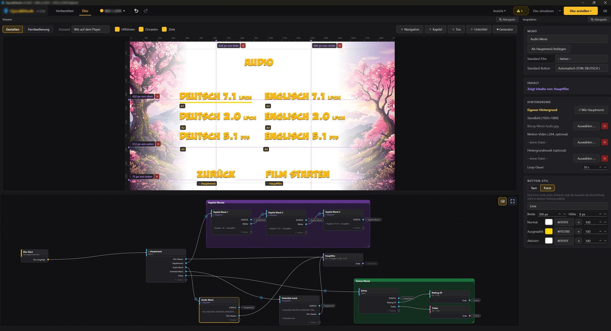
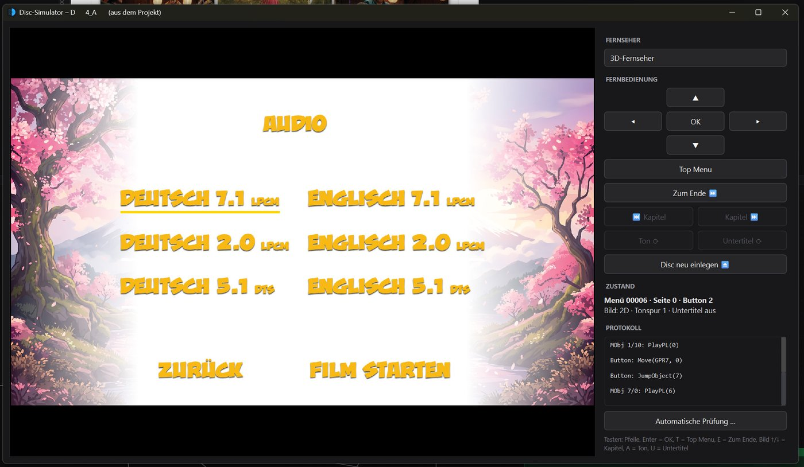

# OpenBDAuth

[](README.md)
[](README.de.md)

[](CHANGELOG.md)
[](#platforms)
[](../../releases/latest)
[](https://www.python.org/)
[](LICENSE)

[](#features)
[](#features)
[](#features)
[](#formats)
[](#formats)
[](#features)
[](#check-a-disc)
[](#features)

**OpenBDAuth** is a free Blu-ray authoring tool. It turns your own footage into **2D and 3D Blu-rays (MVC)** with **real HDMV menus** – arrow-key navigation, multiple menu pages, chapter, audio and subtitle menus – as a BDMV folder or a ready-to-burn ISO. A built-in encoder prepares any source material (MP4, MOV, MKV, 3D as Full-TAB/SBS) for Blu-ray.

Everything happens in a graphical interface: the disc is built as a node graph, menus are designed directly in the viewer. The interface is available in English and German.



*Disc workspace: menu designer with guide lines and target badges, node graph with frames, inspector (German interface).*



*Disc simulator: click through the disc with a virtual remote before burning.*

## Status

OpenBDAuth is developed by one person and tested on the hardware at hand:

- **Players:** Sony UBP-X700, Sony BDP-S4200, PlayStation 3 and a Panasonic DMP-BDT111EG (2D, 3D, menus, chapters, audio and subtitle selection – details in **[HARDWARE_TESTS.md](HARDWARE_TESTS.md)**, German). Other players may behave differently; the HDMV standard leaves room for interpretation.
- **Burning:** confirmed on Windows and macOS with one drive (HL-DT-ST BP40NS20, BD-RE). Burning on Linux is new and currently being tested.
- **Software players** such as VLC support Blu-ray menus only partly. Kodi or a hardware player give a more reliable picture.

Before burning many discs, test one on your player – a BD-RE is ideal for that. Feedback with your player model is very welcome.

---

## Features

### Three workspaces

- **Prepare** – turns any material into disc-ready files:
  - 2D video (H.264, Blu-ray compliant; 720p/1080, 25p as PsF, 30/60 fps adjusted to 29.97/59.94)
  - 3D video from Full-TAB (1920 × 2160) or Full-SBS (3840 × 1080) as MVC (`.264` + `.mvc`), with its own cross-platform MVC path
  - Audio (AC-3, DTS, LPCM; passed through 1:1 where possible)
  - Queue: drop everything in, set options per file, let it run overnight; fill gauge for BD-25/BD-50
  - Results only go onto the disc on request ("Add to film node")
- **Disc** – builds the Blu-ray as a node graph:
  - Start, film and menu nodes; a connection is a jump (button → film, end of film → menu, film → film)
  - The viewer is the menu designer: place buttons freely, guide lines, spacing and alignment snapping, title-safe frame; remote-control mode to try it out
  - Chapter and language menus from templates, custom backgrounds (image or video, with music) per menu
  - 3D films can optionally start in 2D ("Play 2D")
  - Check before export and a **disc simulator**: click through the project or a finished disc with a virtual remote, without burning
- **Burn** – writes a finished ISO 1:1 to Blu-ray (Windows, macOS and Linux):
  - as often as you like, without rebuilding; recently used ISOs, up to 10 copies
  - BD-R and BD-RE (erased when needed), optional verification after burning, ejected only after success

### The resulting Blu-ray

- **HDMV menus** (Interactive Graphics, preloaded menu stream), page changes without loading pauses, buttons with normal / selected / activated states
- **Chapters, audio and subtitles** from the menu; a track chosen during the film is kept for the next start
- **3D (MVC)** with SSIF interleaving; switches to 3D only on 3D-capable players, on 2D TVs the film plays in 2D
- **ISO** with its own UDF 2.50 engine (large files, 3D interleaving)
- **Disc title** shown on the player instead of "BD-RE"
- Bundled fonts (Liberation Sans, Noto Sans) for buttons and subtitles

### Formats

| Type | Disc side (direct) | Prepare (converted) |
|---|---|---|
| Video | H.264 elementary stream (`.264`), `.m2ts` | anything ffmpeg reads (MP4, MOV, MKV, …) |
| 3D | `.264` + `.mvc` (23.976 / 24 fps) | Full-TAB 1920 × 2160 or Full-SBS 3840 × 1080, 23.976 / 24 fps |
| Audio | AC-3, E-AC-3, DTS / DTS-HD, Dolby TrueHD, WAV (LPCM) | WAV, FLAC and other audio files (e.g. MP3, AAC); stereo, 5.1 and 7.1 |
| Subtitles | `.srt` (own renderer), `.sup` (PGS) | – |
| Chapters | DaVinci Resolve marker EDL (`.edl`) | – |

Dolby TrueHD and DTS-HD tracks are passed through to the disc unchanged; OpenBDAuth does not encode them itself. Dolby Atmos and DTS:X inside such tracks are carried along as well, but have not been tested on hardware yet.

Prepare deliberately does not take the audio from a video file: a video only yields the picture. Provide the audio as a separate file in good quality (ideally WAV from your editing software), so a heavily compressed track does not end up on the disc by accident.

---

## Installation

### Platforms

Ready-to-run packages are on the **[Releases page](../../releases/latest)**. They contain everything OpenBDAuth needs (Python, Qt, ffmpeg, ffprobe, tsMuxeR); nothing else has to be installed.

| System | File | Requirements |
|---|---|---|
| Windows | `OpenBDAuth-Setup-<version>.exe` (installer) or `OpenBDAuth-<version>-windows.zip` (portable) | Windows 10 or 11, 64-bit |
| Linux | `OpenBDAuth-<version>-linux.tar.gz` | x86-64 with glibc 2.35 or newer: Ubuntu 22.04, Debian 12, Fedora 36, Linux Mint 21 or newer |
| macOS | `OpenBDAuth-<version>-macos.dmg` | Apple Silicon (M1 or newer), macOS 13 or newer – Intel Macs are not supported |

The packages are not signed with a commercial certificate yet, so Windows and macOS ask once before the first start (see below).

### Windows

- **Installer:** run `OpenBDAuth-Setup-<version>.exe`. It installs for your user without admin rights (optionally for all users) and adds a Start menu entry; uninstall via Settings → Apps.
- **Portable:** unzip the ZIP anywhere and start `OpenBDAuth.exe`. To remove it, delete the folder.
- **First start:** if SmartScreen shows "Windows protected your PC", click **More info** → **Run anyway**.

### Linux

```bash
tar xzf OpenBDAuth-<version>-linux.tar.gz
./OpenBDAuth/OpenBDAuth
```

Nothing is installed; to remove it, delete the folder.

**Burning on Linux** needs `xorriso` from the system and access to the drive:

```bash
sudo apt install xorriso            # Ubuntu, Debian, Mint (Fedora: dnf install xorriso, Arch: pacman -S libisoburn)
sudo usermod -aG cdrom $USER        # Arch/Fedora: group optical; then log out and back in
```

Opening ISOs in the simulator uses `udisksctl` (present on desktops).

### macOS

1. Open the `.dmg` and drag **OpenBDAuth** onto **Applications**.
2. **First start:** macOS reports that it cannot verify OpenBDAuth. Click **Done**, open **System Settings → Privacy & Security**, scroll down and click **Open Anyway** next to OpenBDAuth, then confirm. This is only needed once.
3. If macOS says the app "is damaged and can't be opened", run this once in Terminal:

   ```bash
   xattr -dr com.apple.quarantine /Applications/OpenBDAuth.app
   ```

### From source

Requirements: Python 3.10 or newer.

```bash
python -m venv venv
venv\Scripts\activate            # macOS/Linux: source venv/bin/activate
pip install -r requirements.txt
python tools/fetch_tools.py      # ffmpeg, ffprobe and tsMuxeR into tools/<platform>/ (Windows, Linux, macOS)
python main.py                   # or Start_OpenBDAuth.bat
```

Without `tools/<platform>/`, OpenBDAuth looks for ffmpeg, ffprobe and tsMuxeR in the PATH. `python tools/build_release.py` builds a package for the current system and checks it afterwards (`OpenBDAuth.exe --selbsttest`); on Windows with [Inno Setup 6](https://jrsoftware.org/isinfo.php) installed, also the installer. On GitHub, the workflows "Windows-Paket", "Linux-Paket" and "macOS-Paket" build the packages (Actions → workflow → "Run workflow").

---

## Typical workflow

1. **Prepare:** drop in films, extras and audio tracks, set options per file (2D/3D, bitrate, audio), **Start**.
2. **Add:** move finished files into film nodes with one click (or pick "New film node …" as the target beforehand).
3. **Disc:** create and design menus, add chapter and language menus via the suggestions in the graph, drag subtitles and chapters onto the film node.
4. **Simulate disc** and click through it with the remote.
5. **Create disc** (folder or ISO), write it to Blu-ray under **Burn**, test on the player.

## Check a disc

```bash
python tools/simulate_disc.py <ISO | disc or BDMV folder>          # report for 3D and 2D TVs
python tools/simulate_disc.py <…> --struktur                       # all buttons and MovieObjects in plain text
python tools/simulate_disc.py <…> --fenster                        # click through in the simulator window
```

The disc simulator replays the navigation of the finished disc according to BD-ROM Part 3 and libbluray, presses every button on every page, plays every film to the end and reports errors, warnings and notes together with the path that leads there.

## Tests

```bash
python -m unittest discover tests     # or: python -m pytest tests
```

Some tests need ffmpeg with libx264 and tsMuxeR (skipped otherwise). The click test of the Windows interface only runs with `OPENBDAUTH_GUI_SMOKE=1`.

---

## Documentation

The documentation files are currently in German.

| File | Content |
|---|---|
| [CHANGELOG.md](CHANGELOG.md) | all versions and their changes |
| [HARDWARE_TESTS.md](HARDWARE_TESTS.md) | burn tests per version, player and TV |
| [docs/mvc/](docs/mvc/README.md) | own MVC encoder for Blu-ray 3D: background, phases, measurements |
| [THIRD_PARTY_LICENSES.md](THIRD_PARTY_LICENSES.md) | bundled third-party components and their licenses |

## Project structure

| Folder | Content |
|---|---|
| `core/` | graph data model, export adapter, checks, rules, import, translations |
| `modules/` | Blu-ray generation (`bdmv`, `igs`, `mpls`, `m2ts`, subtitles, UDF), export pipeline, disc simulator (`bdsim`), Prepare (`prepare`) |
| `mvctools/` | MVC rewriter, checks and analysis (pure Python) |
| `gui/` | main window and Disc workspace (`studio`, `node_editor`), Prepare (`prepare`), shared building blocks |
| `tools/` | simulator, tool download, package build |
| `tests/` | unit, interface and end-to-end tests |
| `assets/` | fonts (SIL Open Font License) and program icon |

---

## Legal

- **License:** GPL-3.0 ([LICENSE](LICENSE)). Bundled third-party components (FFmpeg with x264, tsMuxeR, Qt, Pillow, Python, fonts) are under their own licenses, see [THIRD_PARTY_LICENSES.md](THIRD_PARTY_LICENSES.md).
- **No copy protection:** OpenBDAuth creates discs from your own material. It does not circumvent copy protection and does not decrypt content.
- **Patents:** H.264 and MVC are covered by patents in some countries. If you distribute discs commercially, check the situation for your country.

Developed with the help of AI.
